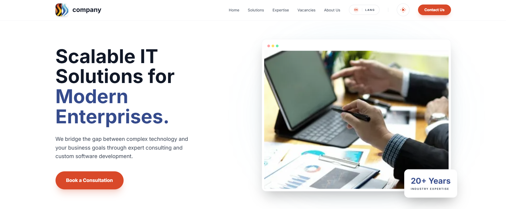
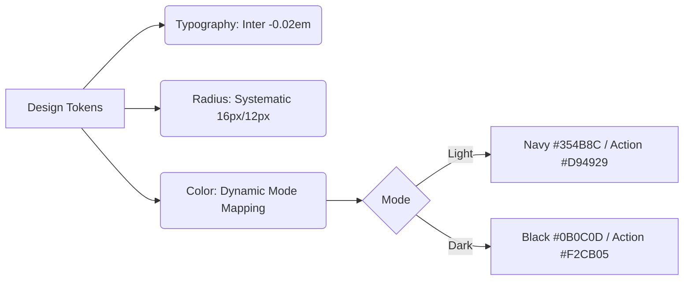

# company Redesign + SEO + AGENT Ready

<div align="center">
  
  
  <p align="center">
    <strong>Enterprise-grade IT Solutions Platform for Modern Digital Transformation.</strong>
  </p>

</div>

---

## 🏛 Architecture & Engineering Standards

This project follows the **"Operational Silence"** design philosophy, implementing a high-performance stack optimized for zero friction and enterprise reliability.

### Core Stack

- **Engine**: [Astro 5.x](https://astro.build) using Server Islands & Partial Hydration.
- **Styling**: [Tailwind CSS](https://tailwindcss.com) with a custom Token-Based System.
- **Standards**: Adhering to **Addy Osmani's** Performance Budgets and **Google Labs'** INP standards.

---

## 🛠 Development Setup

### System Prerequisites

To ensure environment parity, this project requires specific engine versions:

- **Node.js**: `>=22.12.0` (LTS highly recommended)
- **Package Manager**: `pnpm@11.0.2`

### Quick Start

```bash
# Verify environment
node -v # Should be >= 22.12.0
pnpm -v # Should be 11.0.2

# Install dependencies
pnpm install

# Start development server
pnpm dev
```

---

## 🎨 Design System Tokens

Implemented using a **Deterministic UI** approach to prevent Flash of Unstyled Content (FOUC).



### Key UI Features

- **Systematic Radius**: Parent containers (16px) with geometrically correct nested children (12px).
- **Islands of Interactivity**: JavaScript payloads strictly isolated (<50kb) via `client:visible`.
- **Performance Benchmarks**: LCP < 1.2s | CLS: 0 | INP < 200ms.

---

## 📁 Repository Structure

```text
/
├── src/
│   ├── components/   # Atomic UI Islands
│   ├── layouts/      # Master templates & Theme logic
│   ├── pages/        # Route-based entry points
│   └── styles/       # Design System Tokens
├── public/           # Static assets (Optimized via astro:assets)
└── package.json      # Engine: Node >=22.12.0 | pnpm 11.0.2
```

---

## 🏗 Value Propositions

1.  **Custom Software Development**: Workflow automation.
2.  **IT Strategy & Consulting**: Strategic technology roadmaps.
3.  **Cloud & DevOps**: Modernizing legacy systems.
4.  **Managed IT Services**: 24/7 proactive support.

---

## 📬 Contact & Governance

**Company country**  
Connecting Technology and Business.
📧 [info@company.com](mailto:hr@company.com) | 🌐 [company.com](https://company.com)

---

<div align="center">
  <sub>© 2026 company. Engineered with precision in country.</sub>
</div>
